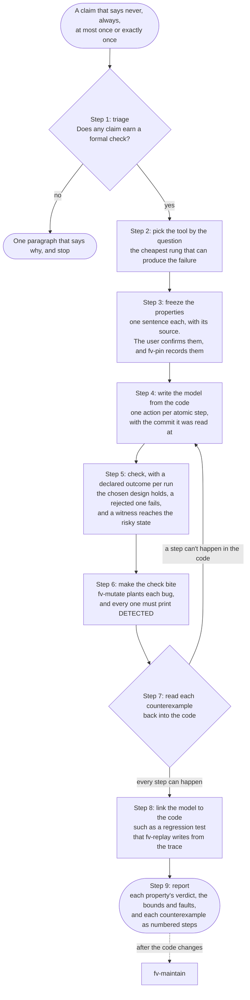
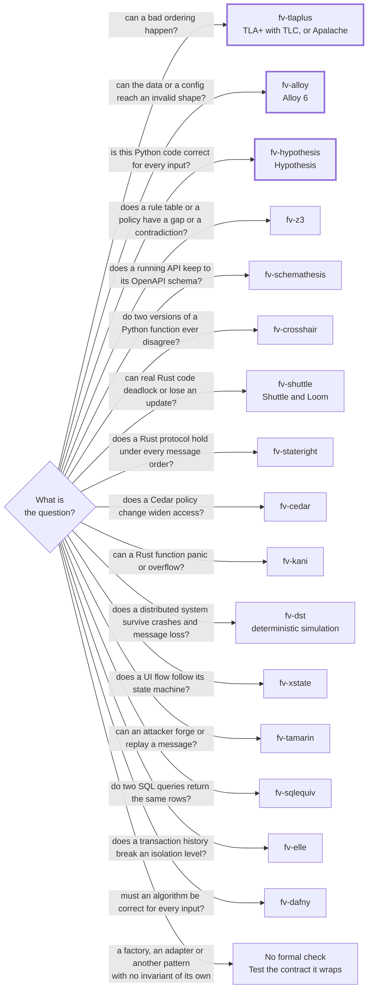
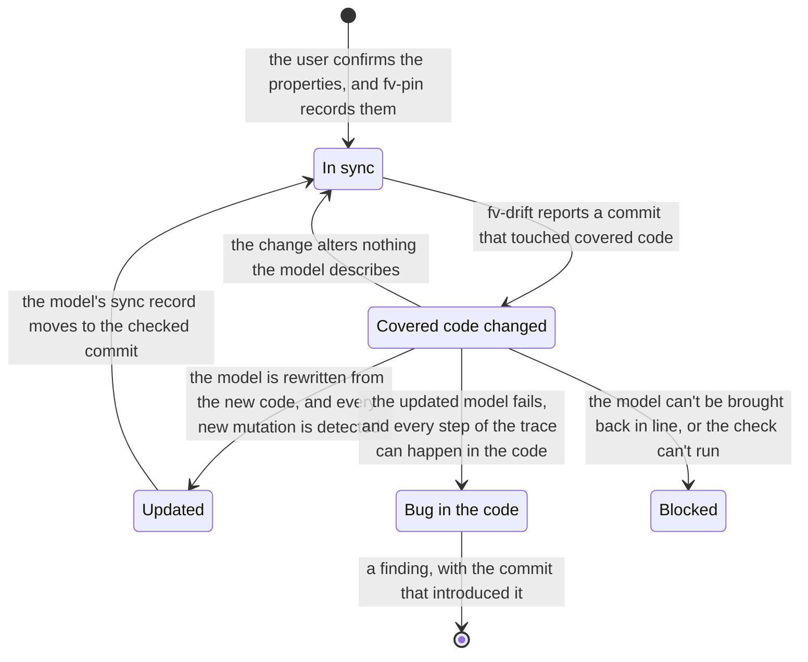

# formal-verification-toolkit

A Claude Code plugin that checks a design or a piece of code with the cheapest formal tool that can produce the failure. A test checks the cases someone wrote. A model checker, a model finder or a property test checks every case in a stated scope.

## Install

```text
/plugin marketplace add aasimsani/formal-verification-toolkit
/plugin install fv-toolkit@formal-verification-toolkit
```

In Codex:

```text
codex plugin marketplace add https://github.com/aasimsani/formal-verification-toolkit
codex plugin add fv-toolkit@formal-verification-toolkit
```

Then install the pinned checkers once. The command needs a JDK 17 or later.

```bash
plugins/fv-toolkit/scripts/fv-install
```

## How it works

You give the `formal-verification` skill a claim, a design or a diff. It decides whether any claim is worth a formal check, picks the tool, and reports a pass only after the check has failed on a planted bug.



A failure of the design you chose is a finding, and it's the most valuable result the loop produces. The skill never weakens a property or a model to make a check pass, and it never calls a bounded check verified or proved.

The tool comes from one question: what is the claim about? The three tools with a thick border are core, and `fv-install` installs the rest the first time they're named.



A model stays true only while the code it covers stays the same. Each model records the commit it was read at, `fv-pin` records the properties the user confirmed, and `fv-maintain` brings a model back in line after the code moves on.



A property changes only when the promise itself changed on purpose, and the change cites its evidence. `fv-pin check` reports any property that changed without the user's agreement.

The repo holds the plugin, its eval and the checks of both.

```text
formal-verification-toolkit/
├── .claude-plugin/marketplace.json    the entry that /plugin marketplace add reads
├── .agents/plugins/marketplace.json   the same entry for Codex
├── plugins/fv-toolkit/                the plugin that /plugin install copies
│   ├── skills/                        18 skills: the router, 3 core tools, fv-maintain and 13 tools on demand
│   ├── references/                    12 files of shared rules, and catalog/ with 166 architecture patterns
│   ├── scripts/                       fv-install, the checker wrappers, and installers/ for each tool on demand
│   └── evals/                         38 eval cases: 29 routing, 4 no-trigger and 5 that run a real checker
├── tests/                             checks of the scripts, the structure and every shipped example
├── docs/                              spec.md, the design behind the skills, and adding-a-tool.md
└── NOTICE.md                          the open-source work this project adapts
```

## Skills

| Skill | What it does |
|---|---|
| `formal-verification` | The router. It triages the claims, picks a tool by the question, freezes the properties, and runs the loop: model, check, plant bugs, replay each counterexample in the code, report. |
| `fv-tlaplus` | Writes and checks a TLA+ model with TLC: one action per atomic step, one config per design with a declared outcome, witnesses and mutations. It ships thirteen checked templates, one per pattern, and eight reproduced anti-patterns. With `fv-install apalache` it also checks whether an invariant is inductive. |
| `fv-hypothesis` | Writes property-based and stateful tests on real Python code, and requires each property to fail on a planted bug in that code. It ships one test file that detects every planted bug beside three that detect none, a stateful test, and three more reproduced anti-patterns. |
| `fv-alloy` | Writes and checks an Alloy 6 model of structure: permissions, ownership, isolation, compatibility. Every check is paired with a satisfiable run, and the check of a rejected design must find its counterexample. It ships six checked models and four reproduced anti-patterns. |
| `fv-maintain` | Brings models back in line after the code changed, and says whether each failure is drift in the model or a bug in the code. |

The router reads its pattern catalogs, property families and fault models from `plugins/fv-toolkit/references/`. `docs/spec.md` is the design document that those files come from.

## Tools on demand

The two core jars install with `fv-install`. Every other tool installs when it is named, for example `fv-install z3`. `fv-install --list` prints every tool the script can install, and `fv-install --check <tool>` reports whether one is ready without installing it. `docs/adding-a-tool.md` is the contract for a new tool.

| Skill | What it does |
|---|---|
| `fv-z3` | Encodes a rule table, a policy diff or a config invariant as a Z3 formula and searches for a violation. It reports `unknown` as an error and never as a pass. |
| `fv-schemathesis` | Generates requests from an OpenAPI schema, checks each response against the schema, and runs sequences of calls such as create, get, delete. |
| `fv-crosshair` | Searches symbolically for an input on which a Python function breaks its contract, and for an input on which two versions of a function disagree. |
| `fv-shuttle` | Runs real Rust concurrent code under Shuttle's randomized scheduler and Loom's exhaustive one, so an interleaving that loses an update or deadlocks is found and replayed. |
| `fv-stateright` | Checks a Rust actor protocol by exploring every state that its `Model` implementation can reach, so the model is the code. |
| `fv-cedar` | Validates Cedar policies against their schema and checks each declared allow or deny decision, so a change that widens access fails. |
| `fv-kani` | Checks a Rust function for panics, overflow and out-of-bounds indexing on every input within an unwind bound, with a cover statement as the witness. |
| `fv-dst` | Writes a deterministic simulator in which one seeded scheduler owns task order, message delay, loss, duplication, crash and restart, so a seed replays a failure exactly. |
| `fv-xstate` | Generates the shortest path to every reachable state of an XState machine and replays each path on the real implementation. |
| `fv-tamarin` | Writes and checks a Tamarin theory of a security protocol against an active attacker, and pairs every safety lemma with a lemma that shows the protocol can run. |
| `fv-sqlequiv` | Checks two SQL queries for equal results on every small table up to a bound, with NULLs and duplicate rows, on SQLite. |
| `fv-elle` | Checks a recorded history of transactions against an isolation level with Elle and names the anomaly, such as G1c or G-single, with the cycle that shows it. |
| `fv-dafny` | Proves a small algorithm against its specification with Dafny, for every input, and reports each assertion that the verifier could not prove. |

Apalache has no skill of its own. `fv-install apalache` adds the symbolic checker to `fv-tlaplus`, which uses it when TLC cannot enumerate the states or when an invariant must be shown inductive.

## Scripts

Every script prints one verdict per line and documents its exit codes in `--help`.

| Script | What it does |
|---|---|
| `fv-install` | Downloads TLC 1.7.4 and Alloy 6.2.0 into `~/.cache/fv` and verifies each jar by SHA-256. A named on-demand tool runs its installer from `scripts/installers/`. |
| `fv-tlc` | Runs TLC on each config and compares the outcome with the config's `\* expect:` header. `--json` prints each counterexample as parsed states. |
| `fv-alloy` | Runs every command of an Alloy model and compares each result with its `expect` clause. |
| `fv-mutate` | Plants each bug from a `.mutations` file in a copy and confirms that the check fails. |
| `fv-replay` | Turns a TLC counterexample into a pytest file that drives the real code through the same steps. |
| `fv-conform` | Checks that a recorded run of the real system, one JSON line per step, is a behaviour of the spec. |
| `fv-pin` | Records a SHA-256 for each confirmed property and declared outcome, and reports any that changed. |
| `fv-drift` | Reports whether the code a model covers has changed since the model's sync commit. |

An on-demand tool may add its own wrapper, such as `fv-z3` or `fv-kani`, and the tool's skill documents it.

A tool that is not installed makes a script exit 3 and print `UNAVAILABLE`. That result means the model was not checked. It is neither a pass nor a failure.

## Tests

```bash
plugins/fv-toolkit/scripts/fv-install
bash tests/test_scripts.sh
bash tests/test_structure.sh
bash tests/test_examples.sh            # every tool that is installed
bash tests/test_examples.sh alloy      # one tool
```

The Hypothesis examples need `uv`, which supplies Hypothesis and pytest for the run. `test_scripts.sh` runs the real TLC and Alloy jars against the fixtures in `tests/fixtures/`. `test_structure.sh` checks that every file a skill names exists. `test_examples.sh` runs every shipped example: a good example must meet its declared outcomes and detect its mutations, and a bad example must produce the symptom its README states.

## Evals

`plugins/fv-toolkit/evals/` holds 38 cases for `claude plugin eval`.

| Group | Cases | A case passes when |
|---|---|---|
| `route/`, one or two scenarios per tool | 21 | The skill of the fitting tool loads, no other tool's skill loads, the reply names the tool, and the plan carries one rule that the tool's skill teaches |
| `route/`, scenarios beside another tool's territory | 7 | The fitting skill loads and the neighbouring skill does not. A commit protocol in C# goes to TLA+ and not to Stateright, for example |
| `route/low-value-target` | 1 | No tool skill loads for a factory and an adapter, and the reply names an ordinary test |
| `no-trigger/` | 4 | No skill of this plugin loads for a git question, a unit test, a type error or a flaky CI job |
| `effect/` | 5 | In a workspace with a planted bug, the agent runs the real checker, shows that its check fails on a planted change, and reports the counterexample without calling a bounded check a proof |

The effect cases cover TLA+, Alloy, Hypothesis, the SQL equivalence check and deterministic simulation. The other tools have routing cases only. No scenario names a tool unless the user's own system is written in it, such as Cedar policies or an XState machine.

```bash
FV_EVAL_JARS=~/.cache/fv claude plugin eval plugins/fv-toolkit --trust-plugin --scaffold \
  --allow-tools Bash Write Edit --ablation none --runs 1 --no-publish
```

The sandbox of a run has no network, so the scaffold of an effect case copies the pinned jars from `FV_EVAL_JARS`. `tests/test_structure.sh` fails when a tool skill has no routing case.

The run of 2026-11-12 on Claude Code 2.1.322 took one sample per case. The Dafny scenario was added after the full run and ran on its own:

| Group | Cases that passed every grader | Cost |
|---|---|---|
| Routing | 29 of 29 | $8.21 |
| No trigger | 4 of 4 | $0.47 |
| Effect | 5 of 5 | $3.67 |

One sample per case does not measure variance. Run with `--runs 3` before you rely on a single case.

## CI

`.github/workflows/ci.yml` installs the pinned jars and runs the three suites on every pull request and on every push to `main`. Each on-demand tool has its own job. A pull request runs the jobs of the tools whose files it changed, and a push to `main` runs every tool.

## License

MIT. See `LICENSE`. `NOTICE.md` lists the open-source work that this project adapts.
